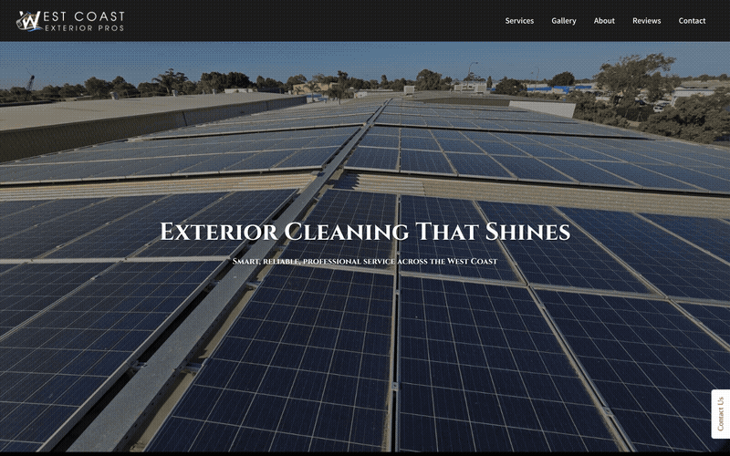
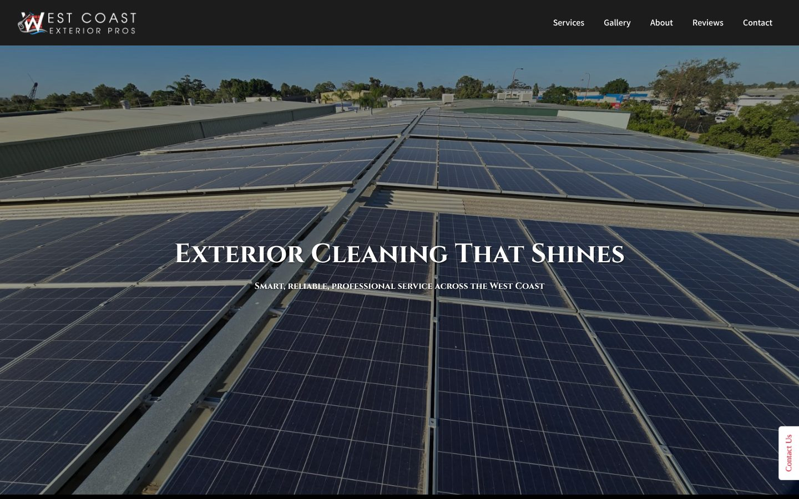

# West Coast Exterior Pros

> Marketing website for a Western Australian exterior-cleaning business — solar panels, roofs, gutters, windows and pressure cleaning.

**Live demo:** [west-coast-exterior-pros.vercel.app](https://west-coast-exterior-pros.vercel.app)

    

## Features

- Full-bleed hero with the brand's tagline and call to action
- Services grid (solar, roof & gutters, windows, pressure cleaning, commercial)
- Before/after gallery carousel
- About section and customer reviews
- Contact form (JotForm embed) plus a floating feedback button
- Scroll-reveal animations (AOS) and smooth in-page scrolling
- Vercel Speed Insights

## Tech stack

- HTML5, CSS3 and vanilla JavaScript
- Bootstrap 5.3, Font Awesome 6, Google Fonts (Cinzel + Assistant)
- AOS (Animate On Scroll)
- JotForm for enquiries
- Hosted on Vercel

## Run it locally

```bash
git clone https://github.com/thedalycreative/west-coast-exterior-pros.git
cd west-coast-exterior-pros
npx serve .        # or: python3 -m http.server 8000
# open http://localhost:3000
```

## Deployment (Vercel)

Static site, no build step (`npm install` only pulls `@vercel/speed-insights`). The Vercel project **west-coast-exterior-pros** is linked to this repo and deploys `main` to production at **https://west-coast-exterior-pros.vercel.app**.

## Screenshots



<p align="center">
  
  
</p>

_Captured from the live site (https://west-coast-exterior-pros.vercel.app). Regenerate with any headless browser; files live in `docs/screenshots/`._

---

Built by [The Daly Creative](https://www.thedalycreative.com) · Perth, WA
